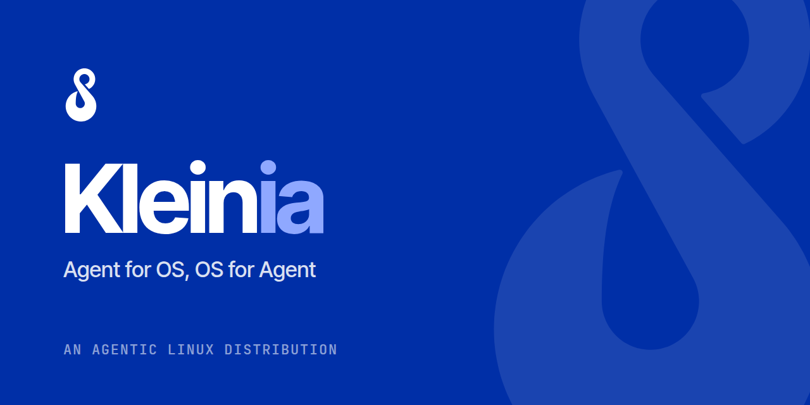

  

<h3 align="center">Agent for OS, OS for Agent.</h3>

  <a href="https://kleinia.io">Website</a> ·
  <a href="https://docs.kleinia.io">Docs</a> ·
  <a href="https://kleinia.io/research">Research</a> ·
  <a href="https://kleinia.io/discord">Discord</a>

---

**Kleinia** is an agentic Linux distribution built on Fedora. It brings agents and the
operating system together in both directions: the system is built for agents, and agents
work for the system.

- **OS for Agent.** Agents are first-class citizens of the system, just like processes.
  Your favourite agents and traditional apps get system-level identity, quotas,
  permissions, memory and context without any modification, and every model call goes
  through one unified model gateway.
- **Agent for OS.** The operating system, now scheduled by agents. A resource agent
  understands what you are doing and switches CPU, I/O and page-cache policies as the
  load changes, while the kernel only ever runs safety-checked, deterministic policies.
- **Anything, anywhere, all as agent.** Applications, services, login sessions and system
  components all exist as agents, each with an `agent://` address, so agents can find and
  call one another, even apps that were never adapted for AI.

Under the hood it is an image-based Fedora system: atomic updates, rollback in one reboot,
and Flatpak apps.

### Where to start

| | |
|---|---|
| 🌱 **Kleinia 0.1 Aloe** | The first technical preview is almost there. Join [Discord](https://kleinia.io/discord) to hear the moment it lands; [kleinia.io/download](https://kleinia.io/download) will have it. |
| 🧭 **Learn the ideas** | [Agent for OS](https://kleinia.io/agent-for-os), [OS for Agent](https://kleinia.io/os-for-agent), and [what "agent-centric" means](https://docs.kleinia.io/concepts/agent-centric-os/). |
| 📄 **Read the research** | [kleinia.io/research](https://kleinia.io/research): ACOS, LAPS, PISA and the work we build on. |
| 🛠️ **Contribute** | Read [CONTRIBUTING.md](https://github.com/kleinia-os/.github/blob/main/CONTRIBUTING.md) and pick an issue labelled `good first issue`. |
| 💬 **Talk to us** | [Discord](https://kleinia.io/discord), or email cjcongjia@zju.edu.cn. |
| 🔒 **Report a vulnerability** | Email **security@kleinia.io**. Please don't use public issues; see [SECURITY.md](https://github.com/kleinia-os/.github/blob/main/SECURITY.md). |

<!--
  Repo map: list only repositories that are PUBLIC at the time this file goes live.
  Links to private repos show visitors a 404. Delete any rows that are still private.
-->
<!-- Trademark owner is still to be confirmed (see website/PLACEHOLDERS.md §4.1); add the
     trademark sentence back once it is. -->
Built by the team that proposed the
<a href="https://arxiv.org/abs/2411.17710">agent-centric operating system</a>.
Kleinia is started and maintained by the <a href="https://vipazoo.com">VIPA Lab</a> · © The Kleinia Authors ·
<a href="https://kleinia.io/brand">Logos and brand</a>
